<!-- ═══════════════════════════════════════════════════════════ -->
<!--                    SOHAM MONDAL | PROFILE                   -->
<!--                  NEON CYBERPUNK EDITION                     -->
<!-- ═══════════════════════════════════════════════════════════ -->

<!-- Animated Header -->

<!-- Typing Animation -->

 

  

---

<!-- ABOUT ME -->

<h2 align="center">⚡ ABOUT ME</h2>

  

Hey! I'm **Soham Mondal**, an aspiring AI/ML Engineer and Computer Science undergraduate pursuing a **B.Tech in Computer Science and Engineering (AI & ML)** at the **Institute of Engineering and Management**.

I'm passionate about exploring the intersection of technology, intelligence, and creativity.

My journey revolves around experimenting with Machine Learning, developing Computer Vision applications, and building projects that transform interesting ideas into practical solutions.

I enjoy exploring technologies like Python, OpenCV, PyTorch, TensorFlow, and JavaScript while continuously challenging myself to learn something new.

When I'm away from the keyboard, you'll probably find me playing cricket, games or drawing something creative. 🏏🎨

 

**💡 My Philosophy**

*"Stay curious. Keep building. Never stop learning."*

---

<!-- CURRENT FOCUS -->

<h2 align="center">🚀 WHAT I'M UP TO</h2>

<table align="center">
<tr>
<td width="50%">

**🧠 Exploring**

- Artificial Intelligence
- Machine Learning
- Deep Learning
- Computer Vision

</td>
<td width="50%">

**⚙️ Building & Learning**

- AI/ML Projects
- Image Processing
- Python Development
- Web Development

</td>
</tr>
</table>

---

<!-- TECH STACK -->

<h2 align="center">🛠️ TECH ARSENAL</h2>

  Technologies and tools I work with and explore.

<h3 align="center">🧠 AI / Machine Learning</h3>

  

  
  

<h3 align="center">💻 Programming & Web Development</h3>

  

<h3 align="center">🔧 Tools & Technologies</h3>

  

---

<!-- PROJECT SHOWCASE -->

<h2 align="center">🔥 FEATURED PROJECTS</h2>

  A collection of things I've built while exploring technology and solving problems.

<table align="center">
<tr>
<td width="50%" valign="top">

<h3 align="center">🔥 Fire Detection Model</h3>

  

  A computer vision project designed to detect fire in real time.

</td>
<td width="50%" valign="top">

<h3 align="center">🛒 Disaster APM</h3>

  

  A disaster management website used to predict disaster and send and recieve alerts.

</td>
</tr>

<tr>
<td width="50%" valign="top">

<h3 align="center">👁️ Face Detection & Recognition</h3>

  

  Face detection and custom-dataset face recognition using OpenCV.

</td>
<td width="50%" valign="top">

<h3 align="center"> ALERT</h3>

  

  An IoT and AI based device which helps in detecting and send emergency response to a location in vehicles for faster actions for accidents.

</td>
</tr>
</table>

---

<!-- GITHUB STATS -->

<h2 align="center">📊 GITHUB ANALYTICS</h2>

  
  

  

---

<!-- ACTIVITY GRAPH -->

<h2 align="center">📈 CONTRIBUTION ACTIVITY</h2>

  

---

<!-- GITHUB TROPHIES -->

<h2 align="center">🏆 GITHUB ACHIEVEMENTS</h2>

  
  

---

<!-- LEETCODE -->

<h2 align="center">🧩 LEETCODE JOURNEY</h2>

  

  

---

<!-- CONTRIBUTION SNAKE -->

<h2 align="center">🐍 WATCH MY CONTRIBUTIONS GET EATEN!</h2>

  

---

<!-- FUN FACT -->

<h2 align="center">🎯 BEYOND THE CODE</h2>

### A little something about me...

🎮 Gaming enthusiast by passion.

🎨 Drawing enthusiast by creativity.

🤖 AI/ML explorer by curiosity.

💻 Developer by choice.

**I believe creativity doesn't stop at coding!**

---

<!-- CONNECT -->

<h2 align="center">🌐 LET'S CONNECT!</h2>

  I'm always open to connecting with fellow developers, AI/ML enthusiasts, and creative minds.

---

<!-- FOOTER -->

### ✨ Thanks for visiting my profile!

**If you find something interesting, don't forget to leave a ⭐**

*Keep Learning • Keep Building • Keep Innovating*

